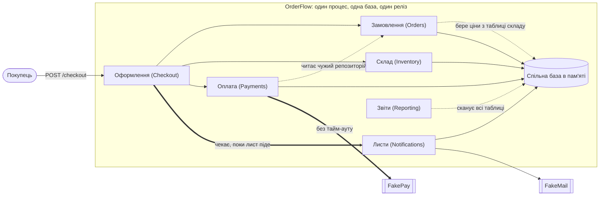
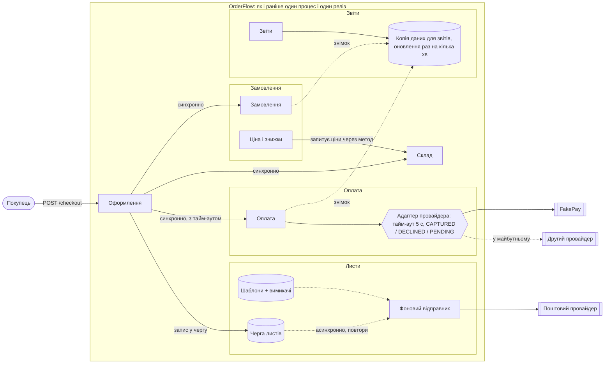

# OrderFlow: як змінювати архітектуру

Коротко: **лишаємо одну програму (modular monolith) і один реліз.** Виправляємо межі між модулями всередині неї. На окремі сервіси поки нічого не виносимо, але записуємо, за яких умов почнемо.

Що реально погано:

1. Лист клієнту стоїть на шляху оплати. Це вже дає списані гроші при скасованому замовленні.
2. Оплата чекає на провайдера без обмеження часу.
3. Модулі лізуть у чужі дані.

Перші два пункти я виправив у коді. Третій тепер контролює автоматичний тест, і він не дасть ситуації погіршитися.

---

## 1. Як система працює зараз



Пунктир позначає залежності, які збільшують ціну змін. Жирна стрілка — довгі синхронні виклики на шляху оплати.

### Хто за що відповідає і де проблеми

| Модуль | Що робить | Від чого залежить | Оцінка |
| --- | --- | --- | --- |
| Оформлення | Проводить покупку: замовлення → склад → оплата → лист | Усі модулі, крім звітів | Сама ідея одного «диригента» хороша. Погано, що він чекає на лист (`CheckoutService.js`, старий рядок 24) |
| Замовлення | Створює замовлення і міняє статус | Таблиця товарів складу (ціни) | Ціну рахує з чужої таблиці (`OrderService.js:16`). У рядку замовлення ціна товару не зберігається |
| Склад | Резервує товар, не дає списати двічі | Тільки свої дані | Добре зроблено: повторний резерв нічого не ламає (`InventoryService.js:9-11`) |
| Оплата | Списує гроші через провайдера | Репозиторій замовлень, FakePay | Читала чужий репозиторій (`PaymentService.js`, старий рядок 12). Тайм-ауту немає. Ім'я `FakePay` вшите в код помилки |
| Листи | Відправляє підтвердження | FakeMail | Шаблон зашитий у код і їде разом з усім релізом |
| Звіти | Рахує продажі | Усі таблиці напряму | Синхронно сканує робочі дані в тому самому потоці Node.js, де проходить оплата. `productPerformance` бере **поточну** ціну, а не ціну на момент покупки |

### Що найбільше робить зміни дорогими

1. **Оформлення синхронно чекає на лист.** Через це 37% змін шаблонів тягнуть за собою повний регрес оформлення.
2. **Замовлення й Оплата зрослися.** Оплата читала репозиторій замовлень, а 48% PR міняють обидва модулі.
3. **Один реліз на всіх.** Будь-яка зміна стає в спільну чергу, а відкат повертає назад усе.
4. **Ціна рахується із чужої таблиці і ніде не зберігається.** Через це знижка (сценарій F) зачепить Замовлення, Оплату й Звіти одночасно.
5. **Звіти читають усі таблиці напряму.** Будь-яка зміна структури даних може тихо зламати звіти.

Не все зчеплення шкідливе. Оформлення як єдиний «диригент» покупки — нормальна залежність. Вона робить процес зрозумілим в одному місці.

### Знахідка, яку я перевірив кодом

Якщо поштовий провайдер падає (FakeMail падає у 2% викликів), блок `catch` в оформленні виконується **вже після успішної оплати**. У результаті:

```text
checkout error: mail down
order: FAILED           ← замовлення скасовано
payment: CAPTURED       ← а гроші списано
stock KEYBOARD: 12      ← товар повернуто на склад
```

Бізнес прямо пише, що доступність оформлення важливіша за миттєвий лист. Код робить навпаки.

---

## 2. Як буде після змін



Суцільна стрілка — синхронний виклик, пунктир — асинхронний. Межа релізу та сама: одна програма. Кожна база всередині належить одному модулю.

---

## 3. Що для нас найважливіше

Характеристики за порядком важливості (architectural characteristics):

| # | Характеристика | Чому саме вона | Чим міряємо |
| --- | --- | --- | --- |
| 1 | **Оформлення працює завжди** (availability, resilience) | Від нього напряму залежить виручка. Два останні інциденти почалися з повільного платіжного провайдера | % успішних оформлень, p95 часу оформлення |
| 2 | **Легко вносити зміни** (modifiability) | Час від ідеї до продакшену виріс з 2 до 6 днів. Одна фіча зачіпає в середньому 4,3 модуля замість 1,7 | Modules Changed per Feature, Change Lead Time |
| 3 | **Правильні гроші й залишки** (data integrity) | Не можна продати товар двічі чи списати гроші без замовлення | Кількість «оплачено, але скасовано», розбіжності на складі |
| 4 | **Швидкий і безпечний реліз** (deployability) | 9% релізів відкочують, і відкат забирає назад усе | Rollback Rate, Deployment Duration |
| 5 | **Звіти витримують ріст** (scalability) | Трафік звітів може зрости у 8–10 разів, але **протягом року**, а дані можуть відставати на кілька хвилин | p95 звітів, вплив на p95 оформлення |

**Чим жертвуємо заради пунктів 1–3:**

- Лист приходить не за секунду, а за кілька секунд чи хвилин.
- Звіти показують дані з відставанням у кілька хвилин.
- Модулі не викладаються окремо.
- Звіти поки не масштабуються окремо.
- Додається трохи коду: черга листів і адаптер провайдера.

---

## 4. Що змінюємо, а що лишаємо

### Сценарії зі змінами і наша відповідь

| Сценарій | Що стається | Що має бути | Як міряємо | Рішення |
| --- | --- | --- | --- | --- |
| A. Часті зміни листів | Маркетинг міняє шаблон 2–3 рази на тиждень | Зміна без релізу всієї програми і без тестування оплати | Час зміни шаблону < 1 дня; < 5% змін потребують тестів оформлення | Лист іде через чергу (**зроблено**). Шаблони стають даними з вимикачем (план) |
| B. Другий платіжний провайдер | Інша модель помилок, підтвердження може прийти пізніше | Новий провайдер додається в одному місці | Нова інтеграція зачіпає ≤ 2 модулі | Адаптер провайдера, статус «чекаємо підтвердження», тайм-аут |
| C. Ріст звітів | Запитів у 8–10 разів більше за рік | Звіти не гальмують оформлення | p95 оформлення не росте під час звітів | Окрема копія даних для звітів (read model) у тому самому процесі. Виносимо тільки за умовою |
| D. Повторний резерв на складі | Повторна команда резерву | Залишок не змінюється двічі | 0 подвійних списань | **Не чіпаємо**: вже працює і покрито тестом |
| E. Повільна оплата | Провайдер відповідає 2–3 с або лежить | Покупець швидко отримує відповідь, лист не впливає на успіх | p95 оформлення ≤ 3,5 с, максимум 5 с | Тайм-аут на оплату; лист поза оформленням (**зроблено**) |
| F. Нова знижка | Знижки міняються щомісяця | Клієнт бачить правильну суму до списання; фінанси бачать знижку у звітах | Знижка = зміна в 1 модулі | Розрахунок ціни в одному місці (Замовлення). Ціну і знижку зберігаємо в рядку замовлення |

### Що змінюємо

1. **Лист більше не блокує оплату (зроблено).** Оформлення лише записує «треба надіслати лист» у чергу (outbox). Фоновий відправник пробує доставити до 5 разів. Один лист на одне замовлення, дублі не створюються.
2. **Оплата не читає чужий репозиторій (зроблено).** Оформлення саме передає в оплату суму, валюту та id замовлення (`PaymentService.chargeOrder(order, token)`).
3. **Адаптер платіжного провайдера (план).** Єдиний внутрішній контракт: `charge → CAPTURED | DECLINED | PENDING`. Тайм-аут 5 с, ключ ідемпотентності = id замовлення. Під нього пишемо FakePay і будь-якого наступного провайдера.
4. **Кожен модуль володіє своїми даними (план, контролює тест).** Ціни запитуємо у Складу через метод, а не читаємо його таблицю. Звіти читають свою копію даних, яка оновлюється раз на кілька хвилин.
5. **Ціна і знижки в одному місці (план).** У рядку замовлення зберігаємо ціну за одиницю та знижку. Так звіти покажуть правильні гроші й після зміни цін.

### Що свідомо лишаємо як є

- **Один процес і один реліз.** У команді 8 інженерів і 2 QA, окремої platform-команди немає. Головна проблема у змішаних межах, а не в тому, що все викладається разом. Якщо винести модулі зараз, межі лишаться змішаними, тільки тепер між ними буде мережа.
- **Одна база даних.** Таблиці розділяємо за власниками, але сам рушій той самий. Окремі бази зараз дали б тільки проблему узгодженості.
- **Синхронне оформлення для складу й оплати.** Покупець має одразу дізнатися, чи пройшла оплата. Склад не може «наздогнати потім», бо тоді буде overselling.
- **Модуль складу та його захист від повторів** — уже виконує сценарій D.
- **Збирання всього в `app.js` з передачею провайдерів через конструктор.** Завдяки цьому тести легко підміняють провайдерів.

### Що робимо з готовою пропозицією (`architecture-proposal.md`)

| Пункт пропозиції | Рішення | Чому |
| --- | --- | --- |
| 1. Зафіксувати контракти між модулями | **Приймаємо** | Дешево, знижує кількість модулів на фічу |
| 2. Власник даних, без чужих репозиторіїв | **Приймаємо поступово** | Тест-«храповик» фіксує поточні витоки і не дає з'явитися новим |
| 3. Асинхронні повідомлення | **Приймаємо частково** | Тільки для листів і копії даних для звітів. Для замовлення, складу й оплати — ні, там потрібна одразу правильна відповідь. Без брокера повідомлень: черга лежить у тій самій базі, бо обслуговувати брокер нема кому |
| 4. Виносити сервіси після перевірки готовності | **Відкладаємо, з умовами** | Див. нижче |
| Ціль «5 окремих сервісів» | **Відхиляємо** | 5 сервісів на 8 людей без platform-команди — це мережеві збої, складний моніторинг і більше координації, а не менше |

### Чи виносити якийсь модуль окремо

**Зараз ні.** Якщо колись виносити, то першими будуть **Листи, а не Оплата.** Це не очевидно, бо Оплата змінюється найчастіше. Але вона стоїть на шляху грошей: винесення додасть мережевий збій прямо в оформлення і змусить розв'язувати узгодженість зі складом через мережу. Листи ж після нашої зміни вже асинхронні, мають простий контракт («замовлення оформлено») і можуть падати без шкоди для виручки.

**Умови для майбутніх змін:**

| Що робимо | Коли |
| --- | --- |
| Листи виносимо в окремий процес | Через квартал після переведення шаблонів у дані маркетинг усе одно потребує релізу коду щотижня, **або** відправник листів помітно навантажує процес оформлення |
| Звіти виносимо в окремий процес з окремою базою | p95 оформлення росте більш ніж на 20% під час важких звітів, **або** трафік звітів перевищує поточний у 4–5 разів |
| Оплату виносимо окремо | Тільки якщо з'явиться окрема команда з чергуваннями і вимога окремого масштабування. Зараз таких умов немає |

---

## 5. Рішення коротко (Decision summary)

```text
Проблема
  Проста зміна зачіпає багато модулів, реліз іде чергою, лист і повільна оплата
  ламають оформлення.

Факти
  - 4,3 модуля на фічу (було 1,7); lead time 6 днів (було 2); rollback 9% (було 2%).
  - 48% PR торкаються Orders і Payments одночасно; Payments читав репозиторій Orders.
  - 37% змін шаблонів листів вимагали повного регресу оформлення: лист стоїть на шляху оплати.
  - Перевірено кодом: падіння пошти -> гроші списані, замовлення FAILED, товар повернуто.
  - 2 останні інциденти почалися з затримок платіжного провайдера; тайм-ауту немає.

Рішення
  Лишаємо modular monolith. Лист — через чергу. Оплата — через адаптер з тайм-аутом
  і не читає чужі дані. Модулі володіють своїми даними. Межі перевіряють тести.
  Окремі сервіси — тільки за названих умов.

Чим платимо
  Лист приходить із затримкою; з'являється фоновий відправник, за яким треба стежити;
  статус оплати «невідомо» після тайм-ауту; звіти трохи відстають.

Як перевіримо
  Modules Changed per Feature, Change Lead Time, Rollback Rate,
  «оплачено, але скасовано» = 0, p95 оформлення + автоматичні тести меж.
```

**Неочевидний компроміс.** Тайм-аут на оплату робить оформлення стабільнішим, але створює новий стан: ми перестали чекати, а провайдер, можливо, гроші вже списав. Без ключа ідемпотентності й нічної звірки (reconciliation) ми поміняємо «повільно» на «двічі списали». Тому тайм-аут вводимо тільки разом з ключем і звіркою.

**Друга неочевидна річ.** Звіти шкодять не тому, що їх багато, а тому, що Node.js однопотоковий: важкий звіт синхронно сканує таблиці й на цей час блокує оформлення. Окремий сервіс тут не потрібен. Досить читати звіти з копії даних і рахувати їх порціями.

---

## 6. Принципи

| Принцип | Де порушено зараз | Де дотримано | Що змінює рішення |
| --- | --- | --- | --- |
| **Приховування деталей** (Information Hiding) | Оплата знала, як зберігаються замовлення. Ім'я `FakePay` вшите в код помилки | Склад ховає механізм захисту від повторів за `reserve()` | Оплата отримує тільки потрібні поля. Провайдер ховається за адаптером |
| **Власник даних** (Ownership) | Замовлення читають таблицю товарів, звіти — усі таблиці | Склад і оплата пишуть тільки у свої таблиці | Кожна таблиця має одного власника. Чужі дані — через метод або копію |
| **Явні контракти** (Explicit Contracts) | Контракт провайдера оплати не описаний. Асинхронного підтвердження немає | Провайдери передаються через конструктор | Контракт `CAPTURED / DECLINED / PENDING`, подія «замовлення оформлено» для листів |
| **Автоматичні перевірки архітектури** (Fitness Functions) | Межі тримались на коментарях «Deliberate boundary leak» | — | `tests/architecture.test.js` падає, якщо з'явився новий витік |

---

## 7. Ризики

Формула: **очікувана втрата = ймовірність × шкода** (`docs/analysis-tools.md`).

**Припущення:**

- приблизно 400 замовлень на день по $150, тобто близько $2 500 виручки за годину;
- година інженера коштує $50;
- період — квартал.

Числа приблизні. Важливий порядок величин.

| Ризик | Ймовірність (квартал) | Шкода | Очікувана втрата | Що робимо |
| --- | --- | --- | --- | --- |
| **R1. Падіння пошти скасовує оплачене замовлення** (є зараз) | ~2% замовлень ≈ 720 випадків | ~$40 на випадок: повернення грошей, підтримка, втрачений клієнт | **≈ $28 800** | Лист через чергу — **зроблено**, тест є |
| **R2. Повільний провайдер оплати вішає оформлення** (є зараз) | ~3 інциденти (2 останні вже були такі) | ~$2 000 за інцидент: 95 хв відновлення, втрачено ~30% замовлень, робота команди | **≈ $6 000** | Тайм-аут 5 с, адаптер, сповіщення по p95 провайдера; згодом другий провайдер для резерву |
| **R3. Межі знову розповзаються** | 0,6 без перевірки | ~$5 000: зайві години на зміни, «податок архітектури» | **≈ $3 000** | Тест-«храповик» у CI. Список витоків може тільки скорочуватись |
| **R4. Звіти гальмують оформлення** | 0,5 (росте з трафіком) | ~$2 000: 2 епізоди по ~$1 000 | **≈ $1 000** | Копія даних для звітів і порційні обчислення. Сума мала, тому окремий сервіс для звітів **не окупається** |
| **R5. Новий ризик від нашого рішення: стан «невідомо» після тайм-ауту оплати** | 0,5 | ~20 замовлень × $50 на ручну звірку чи повернення = $1 000 | **≈ $500** | Ключ ідемпотентності = id замовлення, статус `PENDING`, нічна звірка з провайдером |
| **R6. Новий ризик від нашого рішення: відправник листів зупинився або шле дублі** | 0,3 | ~$900: години без листів, звернення в підтримку, виправлення | **≈ $270** | Один лист на замовлення (вже в коді), сповіщення «найстаріший лист у черзі > 15 хв», статус `FAILED` видно у звітах |

**Висновок з таблиці:** R1 і R2 коштують на порядок більше за решту, тому з них і починаємо. R4 дешевий, і це аргумент **не** виносити звіти зараз.

---

## 8. Скільки коштує зміна

### Зміна 1: новий шаблон листа (сценарій A, 2–3 рази на тиждень)

| | Було | Стане |
| --- | --- | --- |
| Які модулі | Листи + регрес оформлення в 37% випадків + реліз усієї програми | Шаблон як дані: 0 модулів у коді; або тільки Листи |
| Години | 2 год коду + 4,2 год тестів (0,37 × 8 + 0,63 × 2) + 1,5 год на погодження релізу + ризик відкату (9% × 4 год) ≈ **8 год ≈ $400** | 0,5 год правки + 1 год перегляду + 0,25 год увімкнення ≈ **1,75 год ≈ $90** |
| Координація | Спільне релізне вікно, чекати до 3,5 днів | Немає; вимикач спрацьовує за хвилини |
| Тести | Іноді весь регрес оформлення | Перегляд шаблону й тести модуля Листи |
| Що викладаємо | Усю програму | Нічого (дані) або тільки код листів |

**«Податок архітектури»** ≈ $400 − $90 = **$310 на зміну**. При ~32 змінах на квартал це близько **$10 000 на квартал**, причому без урахування днів очікування для маркетингу.

### Зміна 2: другий платіжний провайдер (сценарій B)

| | Було | Стане |
| --- | --- | --- |
| Які модулі | Оплата, Оформлення, Замовлення (новий статус), Звіти, спільні помилки — 5 | Оплата (новий адаптер) + Оформлення (обробка `PENDING`) — 2 |
| Години | 60 розробка + 15 координація + 30 тести + 8 реліз ≈ **113 год ≈ $5 650** | 45 + 5 + 18 (контрактні тести адаптера) + 8 ≈ **76 год ≈ $3 800** |

Різниця тут менша, ніж у листах, і це чесно. Асинхронне підтвердження оплати — нова бізнес-логіка, і архітектура її складність не прибере. Вона лише прибирає зайві зачеплені модулі й координацію.

---

## 9. Як зрозуміти, що допомогло

| Показник | Зараз | Ціль за 2 квартали | Чому важливий |
| --- | --- | --- | --- |
| Modules Changed per Feature | 4,3 | **< 2,5** | Прямо показує, чи стали межі чистішими |
| Change Lead Time | 6 днів | **≤ 3 дні** | Це те, що бачить бізнес |
| Rollback Rate | 9% | **≤ 4%** | Менше змішаних змін → менше відкатів |
| «Оплачено, але скасовано» | ~2% замовлень (оцінка) | **0** | Головний ризик R1 |
| Зміни шаблонів, що потребують регресу оформлення | 37% | **< 5%** | Перевіряє, що листи справді відокремились |
| p95 часу оформлення під час повільного провайдера | Не обмежено | **≤ 3,5 с, максимум 5 с** | Сценарій E |
| Mean Time to Restore | 95 хв | **≤ 45 хв** | Менша зона ураження → швидше лагодимо |

**Як ці показники можуть показати, що ми помилились:**

- Модулів на фічу стало менше, а lead time не впав. Отже, гальмує процес (2 senior-рев'юери, одне тестове середовище, вікно двічі на тиждень), а не архітектура. Тоді перестаємо вкладатися в межі й займаємося процесом.
- Інциденти через затримки оплати лишились і після тайм-ауту. Тоді потрібен резервний провайдер і circuit breaker, і тільки після них варто думати про винесення Оплати.
- p95 оформлення не росте навіть при 5-кратному трафіку звітів. Тоді копія даних для звітів не потрібна, і ми її не робимо.

### Автоматичні перевірки архітектури (Fitness Functions)

Уже в коді, запускаються через `npm test`:

| Перевірка | Файл |
| --- | --- |
| Модулі читають тільки свої таблиці. Поточні витоки записані в список, який **може тільки скорочуватись**: новий витік валить тест, і виправлений витік теж, поки його не прибрали зі списку | `tests/architecture.test.js` |
| Модулі не імпортують один одного напряму, тільки `shared/` | `tests/architecture.test.js` |
| Платіжний провайдер доступний тільки всередині Оплати, а репозиторій замовлень — тільки всередині Замовлень | `tests/architecture.test.js` |
| Оформлення проходить, коли пошта лежить, а лист доставляється пізніше | `tests/checkout.test.js` |

Я перевірив, що перевірка працює: додав у Оплату `this.database.orders`, і тест упав з повідомленням `payments -> orders`.

**Наступні перевірки:**

- Якщо провайдер оплати завис, оформлення відповідає за ≤ 5 с.
- Правило рев'ю: PR, що одночасно міняє Замовлення та Оплату, пояснює, чому так. Відстежуємо частку таких PR: 48% → < 20%.

---

## 10. AI і час виходу фічі (Time to Market)

### Чому «AI в 4 рази швидше» ≠ «реліз за 1 місяць»

Написання коду займає **40 із 120 днів, тобто третину**. Навіть якщо воно займе 0 днів, лишаються 80 днів (≈ 2,7 місяця). Навіть якщо взяти **найкращі** цифри з таблиці команди для всіх етапів одночасно, виходить 15 + 10 + 15 + 15 + 4 = **59 днів ≈ 2 місяці**. До того ж ці покращення частково перекриваються, і просто додати їх не можна.

### Оцінка по етапах

| Етап | Зараз | Найближча фіча (без вкладень) | Через 2–3 квартали (з вкладеннями) | Що прискорює | Що гальмує |
| --- | ---: | ---: | ---: | --- | --- |
| Аналіз | 20 | 19 | **17** (15–18) | AI для дослідження й прототипів | Доступність стейкхолдерів (процес) |
| Написання коду | 40 | 28 | **22** (18–25) | AI для заготовок, тестів, рефакторингу | Рев'ю чекає двох senior; людське рев'ю безпеки та фінансів; немає базової частоти дефектів AI-коду |
| Інтеграція | 25 | 28 | **18** (15–21) | Контракти, контрактні тести, менші зміни, менше модулів на фічу | Більші PR від AI спершу **збільшують** інтеграцію; одне тестове середовище |
| Перевірка (QA) | 25 | 25 | **18** (15–20) | Друге тестове середовище, автоматизація, паралельні тести | 2 QA; регрес усієї програми, бо реліз один |
| Реліз | 10 | 10 | **7** (5–8) | Частіші релізні вікна, менший обсяг релізу | Ручні погодження; усі модулі в одному релізі |
| **Разом** | **120 (4 міс.)** | **110 (≈ 3,7 міс.)** | **82 (≈ 2,7 міс.; діапазон 68–92)** | | |

### Моя ціль

- **Наступна велика фіча: 3,5–3,7 місяця.** Без інших змін AI прискорює тільки написання коду, а більші PR частину виграшу з'їдають на інтеграції.
- **Через 2–3 квартали: 2,5–3 місяці.** Це реально, якщо зробити вкладення, описані нижче.
- **1 місяць для цілої великої фічі за поточних умов нереальний.** Він можливий хіба для **першої корисної частини** фічі, і тільки після зміни процесу.

### Що обмежує: архітектура окремо, процес окремо

| Архітектурні обмеження | Процесні обмеження |
| --- | --- |
| Один реліз для всіх модулів → регрес усього | Одне тестове середовище, черга 3–5 днів |
| Замовлення й Оплата міняються разом (48% PR) | Релізне вікно двічі на тиждень, ручні погодження |
| Лист на шляху оплати → тести оформлення на кожну зміну листа | Рев'ю чекає двох senior-інженерів |
| Немає контрактів між модулями → широка інтеграція | Людське рев'ю безпеки та фінансів (воно потрібне, лишаємо) |
| | Немає базової частоти дефектів AI-коду; стейкхолдери не завжди на зв'язку |

AI не вирішує жодного пункту з правої колонки.

### Що треба, щоб вийти на 2,5–3 місяці (вкладення)

| Що | Вартість |
| --- | --- |
| Друге тестове середовище | Гроші на інфраструктуру |
| Контрактні тести між модулями | ~2–3 тижні одного інженера, потім підтримка |
| Частіші релізи (наприклад, щодня) з автоматизацією | ~2 тижні |
| Рев'ю розподілене між більшою кількістю людей | Парне рев'ю, кожен модуль має власника |
| Заміри дефектів AI-коду з першої ж фічі | — |

**Ціна переходу:** приблизно квартал команда витрачає ~20% часу на ці речі, тому спершу час виходу фіч може навіть трохи **зрости**.

### Що має змінитися для справжнього місячного циклу

- Етапи не йдуть по черзі. Фіча ріжеться на малі частини, і кожна проходить усі етапи сама.
- Інтеграція безперервна, а не окремий етап на 25 днів.
- Реліз на вимогу, з вимикачами функцій.
- Тестові середовища створюються під кожну зміну.
- Рішення стейкхолдерів — за дні, а не тижні.
- Тільки після цього стане потрібним окремий реліз найактивніших модулів.

### Нові ризики від того, що коду пишеться більше

- PR стають більшими (вже 520 рядків), і черга на рев'ю росте.
- Більше дефектів, а порівняти нема з чим (немає бази).
- Помилки безпеки та фінансів у згенерованому коді.
- Черга на одне тестове середовище росте.
- AI копіює наявні «погані» залежності. Від цього захищають тести меж.

### Як міряти реальний вплив AI (не рядками коду й не кількістю PR)

- Час на кожному етапі окремо.
- Час очікування рев'ю.
- Частка невдалих змін і відкатів для PR з AI і без нього.
- Дефекти, знайдені вже в продакшені.
- Скільки коду переписали протягом 2 тижнів після злиття.
- Наскрізний lead time.

### Коли переглянемо прогноз (після першої великої фічі)

| Що побачимо | Що робимо |
| --- | --- |
| Код написали за ≤ 15 днів, і рев'ю не стало довшим | Ціль сміливішу: 2–2,5 місяця |
| Рев'ю чекає > 5 днів або відкатів > 15% | Вузьке місце перемістилось на рев'ю та якість. Ціль лишається ~3 місяці, вкладаємось у рев'ю |
| Інтеграція росте разом із розміром PR | Вводимо ліміт розміру PR і пришвидшуємо контрактні тести |

---

## 11. Що змінено в коді

| Файл | Зміна |
| --- | --- |
| `src/checkout/CheckoutService.js` | Лист ставиться в чергу після успішної оплати і більше не може відкотити оплачене замовлення |
| `src/notifications/NotificationService.js` | Черга листів (outbox): до 5 спроб, без дублів, статуси `QUEUED / SENT / FAILED` |
| `src/server.js`, `src/demo.js` | Фоновий відправник листів |
| `src/payments/PaymentService.js`, `src/app.js` | Оплата отримує дані замовлення від Оформлення і не читає репозиторій Замовлень |
| `tests/architecture.test.js` | Автоматичні перевірки меж між модулями |
| `tests/checkout.test.js` | Тест «пошта лежить → оформлення проходить, лист піде пізніше» |

`npm test`: 10 з 10 тестів проходять.
